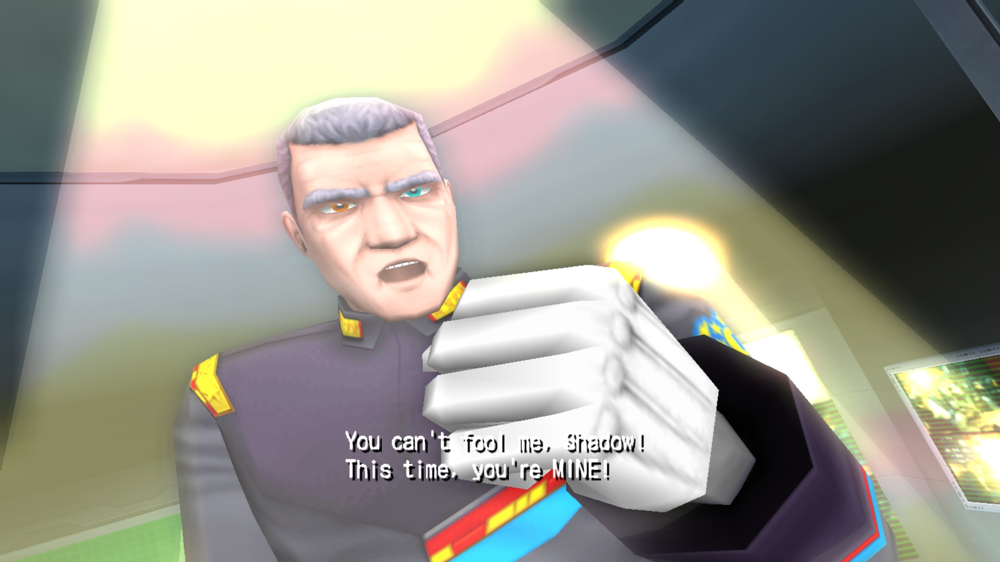
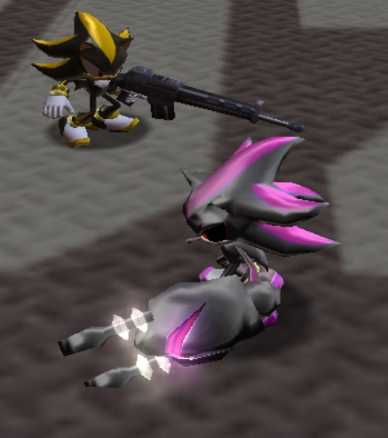
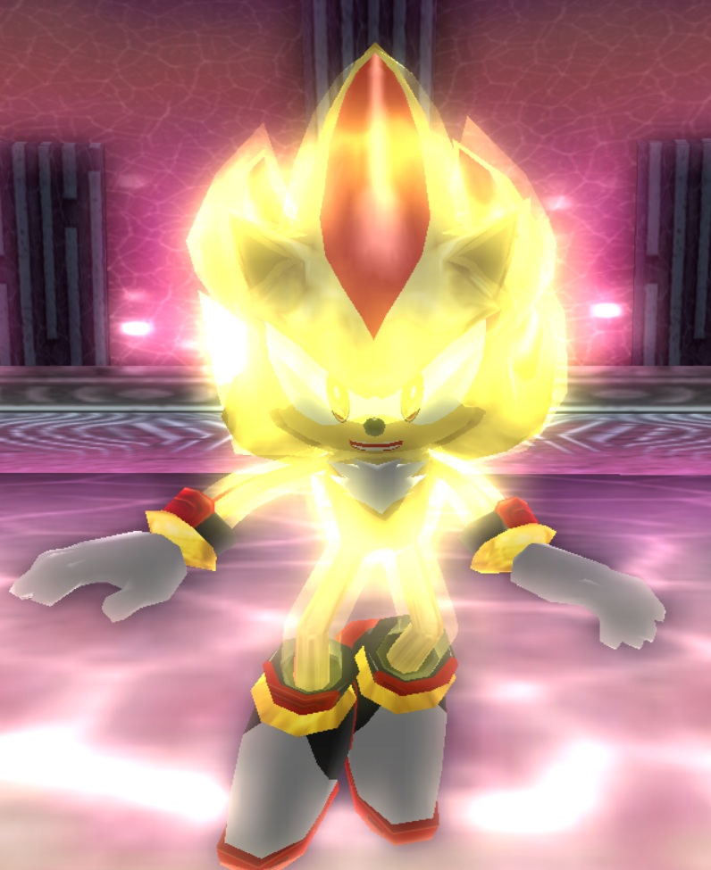
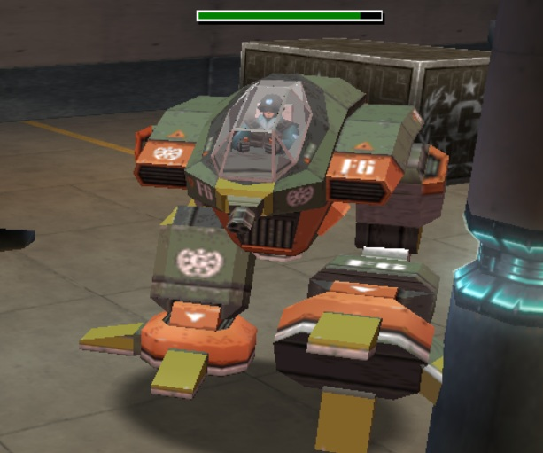
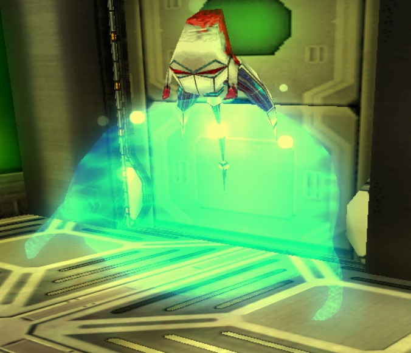

<h1>Corrections to errors in models (for Shadow Recomp by Fox Workshop)</h1>

## About

This repo contains model fixes for the original Shadow the Hedgehog game.

Feel free to distribute or use these in your own mods as you wish.

They are already included by default in the Shadow Reloaded mod.

## What issues are fixed?
* The Yellow Android's left hand material stops rendering when a weapon is held
* The Pink Android's weapon extension material is not rendering
* Artificial Chaos eye glow is incorrectly rotated 90 degrees
* BigFoot cockpit transparency is broken
* GUN Commander's hand rig is broken in event 1101
* Super Shadow's rings are unlit in event 8601 and 0926
